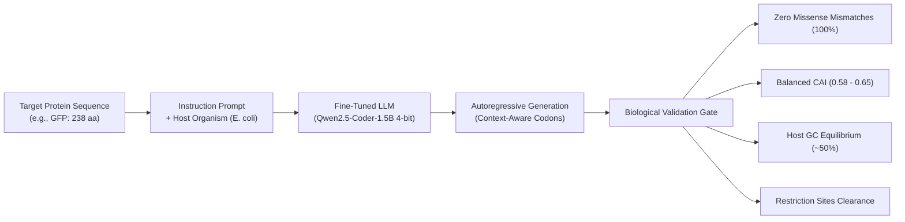

# LLM-Based Codon Optimization Pipeline

[](https://python.org)
[](https://pytorch.org)
[](https://github.com/unslothai/unsloth)
[](https://huggingface.co/aakashdandekar2006/Qwen-Coli-1.5B)
[](LICENSE)

> Fine-tuning autoregressive Large Language Models to translate proteins into biologically harmonized DNA coding sequences—learning contextual biology where classical algorithms fail.

---

## The Problem in Plain English

### The "Dialect" of Life
Imagine two people who both speak English, but one speaks Elizabethan English and the other speaks modern technical English. They share the same underlying dictionary, but attempting to communicate across dialects without adaptation leads to confusion and inefficiency.

Biology exhibits a parallel phenomenon:
* **The Genetic Code:** DNA is written in triplet nucleotide sequences called **codons**. Each codon instructs the cellular translation machinery (the ribosome) to incorporate a specific amino acid into a growing polypeptide chain.
* **Degeneracy:** There are **64 possible codons**, but only **20 standard amino acids**. Nature features synonymous redundancy: for example, the amino acid *Leucine* can be encoded by six distinct codons (`TTA`, `TTG`, `CTT`, `CTC`, `CTA`, or `CTG`).
* **Codon Usage Bias:** A human cell and an *Escherichia coli* bacterial cell utilize synonymous codons with markedly different frequencies. A human gene is adapted to human tRNA pools and cellular kinetics. Introducing human coding sequences directly into a bacterial host to produce recombinant therapeutics (such as **insulin, monoclonal antibodies, or vaccine antigens**) frequently causes translational pauses, premature termination, protein misfolding, or severely compromised yields.

**Codon optimization** is the process of redesigning a coding sequence to match a target host's expression machinery **without altering the primary amino acid sequence of the resulting protein**.

---

## Limitations of Classical Heuristic Optimization

For a representative 300-amino-acid protein, there are more than **$10^{150}$ possible synonymous DNA sequences**—vastly exceeding the number of atoms in the observable universe ($10^{80}$). Consequently, exhaustive search is computationally intractable.

Classical bioinformatic tools typically employ a **greedy frequency substitution**: querying a lookup table and replacing every amino acid with the host's single most frequent synonymous codon to maximize the Codon Adaptation Index (CAI = 1.0).

While this maximizes theoretical elongation rates, it frequently causes heterologous expression failures in wet-lab experiments:

| Classical Failure Mode | Mechanistic Cause | Biophysical Consequence |
|---|---|---|
| **Disrupted Co-Translational Folding** | Nascent polypeptide chains fold hierarchically as they exit the ribosome exit tunnel. Slower codons provide essential pause intervals allowing modular domains to fold sequentially. | Protein misfolding and insoluble inclusion body aggregation. |
| **Destroyed 5' Translation Ramp** | Endogenous high-expression transcripts feature slower, rarer codons across the initial 30–50 codons to meter ribosomal entry. | Ribosomal stacking, steric collisions, and premature abortive translation. |
| **Dicodon and Context Invariance** | Table lookups ignore codon-pair (dicodon) bias. Certain adjacent codon pairs cause severe translation pauses due to steric incompatibility between adjacent tRNAs in the A and P ribosomal sites. | Ribosome stalling and translational arrest. |
| **Repetitive Motifs and Synthesis Failures** | Monotonous codon selection introduces homopolymeric runs and stable secondary structures (hairpins) in the mRNA. | Decreased mRNA stability and chemical DNA synthesis rejection by oligo manufacturers. |

---

## The Learned Sequence Model Approach

DNA functions as a sequential language characterized by syntax, cadence, and long-range structural constraints.

This pipeline fine-tunes an autoregressive Large Language Model (**Qwen2.5-Coder-1.5B**) using **4-bit Quantized Low-Rank Adaptation (QLoRA)** via Unsloth. By training on thousands of validated endogenous genes, the model learns:
1. **Context-Conditioned Codon Selection:** Conditioning each codon choice on preceding nucleotide and amino acid context.
2. **Physiological Harmonization:** Achieving balanced codon adaptation ($0.55 - 0.75$ CAI) matching natural high-expression transcripts rather than artificial, destabilizing 1.0 maximization.
3. **Cloning Compatibility:** Selecting synonymous alternatives that avoid forbidden restriction endonuclease recognition sites (e.g., *EcoRI*, *BamHI*, *XhoI*, *NdeI*).
4. **Accessible Compute:** Engineered to execute fine-tuning and inference efficiently on single consumer GPUs (verified on an **NVIDIA GeForce RTX 4050 Laptop GPU with 6 GB VRAM**).

---

## Pipeline Architecture



---

## Benchmark Results

Comparative evaluation of the fine-tuned LLM against the traditional greedy frequency optimizer on Green Fluorescent Protein (**GFP**, 238 amino acids):

| Metric | LLM Model (This Pipeline) | Traditional Greedy | Biological Significance |
|---|:---:|:---:|---|
| **Translation Integrity** | **PASS** (100% Identity) | **PASS** (100% Identity) | Hard constraint: zero missense or nonsense mutations across all 238 residues. |
| **Generated Length** | **714 nt** (Exact frame) | **714 nt** (Exact frame) | Exact $3 \times L$ coding sequence with verified in-frame translation. |
| **Codon Adaptation Index (CAI)** | **0.609** (Harmonized) | **1.000** (Artificially maxed) | Corresponds to natural endogenous expression; preserves folding kinetics. |
| **GC Content** | **52.1%** | **48.6%** | Within optimal host physiological equilibrium ($45\% - 55\%$). |
| **Context Awareness** | **Autoregressive ($k$-mer)** | **None (Position-independent)** | Accounts for dicodon interactions and translational ramp structure. |
| **Peak GPU VRAM** | **< 5.7 GB** | CPU | Executable on single consumer-tier GPU hardware. |

```
Sequence translated successfully with zero amino acid mismatches.

First 60 nucleotides:
  Model: ATGTCTAAAGGGGAAGAATTGTTTACCGGAGTAGTTCCCATCCTCGTCGAGCTCGACGGC...
  Naive: ATGAGCAAAGGCGAAGAACTGTTTACCGGCGTGGTGCCGATTCTGGTGGAACTGGATGGC...
```

---

## Quickstart

### 1. Prerequisites and Installation
Requires **Python 3.10–3.12** and a CUDA-capable GPU.

```bash
# Clone the repository
git clone https://github.com/aakashdandekar/llm-codon-optimization.git
cd llm-codon-optimization

# Create and activate a virtual environment
uv venv .venv --python 3.12
source .venv/bin/activate

# Install dependencies
uv pip install -r requirements.txt
```

### 2. Data Collection and Validation (Optional)
Extract, format, and validate sequence pairs from repositories or generate synthetic controls conforming to biological schema rules:

```bash
python main.py --collect --max-samples 5000
```

### 3.  Fine-Tuning
Fine-tune the model with 4-bit QLoRA and response-only loss masking:

```bash
python main.py --tune
```

### 4. Inference and Benchmarking
Execute the comparative benchmark using either your locally trained checkpoint or the pre-trained model directly from Hugging Face:

```bash
# Run benchmark using pre-trained weights from Hugging Face
python main.py --test --model aakashdandekar2006/Qwen-Coli-1.5B

# Run benchmark on local checkpoint
python main.py --test

# Optimize a specific custom protein sequence
python main.py --test --model aakashdandekar2006/Qwen-Coli-1.5B --protein "MAENQKKIQNALEKLKASRLEKATLLEEKLRQSQEELQRQRKQEERKRQEEKL"
```

---

## Scientific and Implementation Details

### Codon Adaptation Index (CAI) Mathematical Definition
The Codon Adaptation Index (Sharp & Li, 1987) calculates the geometric mean of relative adaptiveness values ($w_i$) across a gene:

$$w_i = \frac{f_i}{\max_{j \in \text{syn}(aa)} f_j}$$

$$\text{CAI} = \exp\left( \frac{1}{L} \sum_{k=1}^{L} \ln(w_k) \right)$$

* $f_i$ denotes the frequency of codon $i$ in the reference host genome.
* $\max_{j \in \text{syn}(aa)} f_j$ is the frequency of the most abundant synonymous codon for that amino acid.
* Methionine (`ATG`) and Tryptophan (`TGG`) have no synonymous alternatives ($w_i = 1.0$) and are excluded from the summation.
* An artificial score of **1.0** indicates that every position was substituted with the host's highest-frequency codon. Endogenous, properly folded proteins typically exhibit balanced CAI values between **0.55 and 0.80**.

### QLoRA Fine-Tuning Parameters
* **Base Architecture:** `Qwen2.5-Coder-1.5B-Instruct`
* **Quantization:** 4-bit NormalFloat (NF4) with Double Quantization (`bitsandbytes`)
* **LoRA Rank ($r$):** 16 | **LoRA Alpha ($\alpha$):** 32 | **Dropout:** 0
* **Target Modules:** All linear attention and feedforward projections (`q_proj`, `k_proj`, `v_proj`, `o_proj`, `gate_proj`, `up_proj`, `down_proj`)
* **Objective:** Cross-entropy loss with **response-only masking** (`unsloth.chat_templates.train_on_responses_only`), ensuring gradient updates are computed strictly over the generated DNA sequence and terminating `<|im_end|>` token.

---

## Model Availability

The fine-tuned model checkpoint and LoRA adapter weights are published on the Hugging Face Hub:
* **Model Repository:** [aakashdandekar2006/Qwen-Coli-1.5B](https://huggingface.co/aakashdandekar2006/Qwen-Coli-1.5B)
* **Base Architecture:** `unsloth/Qwen2.5-Coder-1.5B-Instruct-bnb-4bit`

---

## License

This project is licensed under the **Apache License, Version 2.0**. See the [LICENSE](LICENSE) file for complete details.

---

## Contributing and Acknowledgments

Contributions and inquiries are welcome.
* Built using [Unsloth](https://github.com/unslothai/unsloth) for accelerated LLM fine-tuning.
* Biological reference distributions sourced from the [Kazusa Codon Usage Database](https://www.kazusa.or.jp/codon/).
