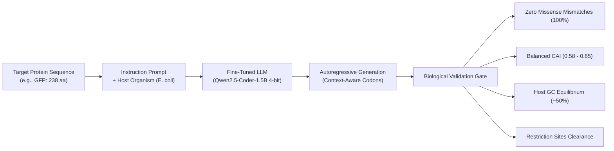

# 🧬 LLM-Based Codon Optimization Pipeline

[](https://python.org)
[](https://pytorch.org)
[](https://github.com/unslothai/unsloth)
[](https://huggingface.co)
[-76B900?logo=nvidia&logoColor=white)](https://nvidia.com)
[](LICENSE)

> **Fine-tuning autoregressive Large Language Models to translate proteins into biologically harmonized DNA coding sequences—learning contextual biology where classical algorithms fail.**

---

## 📖 The Problem in Plain English

### The "Dialect" of Life
Imagine two people who both speak English, but one speaks Shakespearean English and the other speaks modern American slang. They share the same underlying dictionary, but if you drop Shakespearean phrasing into a modern boardroom, communication slows down or breaks entirely.

Biology works the exact same way:
* **The Dictionary (The Genetic Code):** DNA is written in 3-letter "words" called **codons**. Each codon instructs the cellular factory (the ribosome) to add a specific amino acid to a growing protein chain.
* **Synonyms (Degeneracy):** There are **64 possible codons**, but only **20 standard amino acids**. That means nature has built-in synonyms. For example, the amino acid *Leucine* can be spelled in six different ways: `TTA`, `TTG`, `CTT`, `CTC`, `CTA`, or `CTG`.
* **The Dialect (Codon Bias):** A human cell and an *E. coli* bacterial cell speak completely different codon dialects. A human gene uses codons suited to human cellular machinery. If you take that human gene and insert it directly into a bacterium to manufacture life-saving medicines (like **insulin, antibodies, or vaccine antigens**), the bacterium stumbles, pauses, misfolds the protein into useless clumps, or produces almost nothing.

**Codon optimization** is the art of translating a protein sequence into a host's preferred DNA dialect—**without altering a single amino acid in the resulting protein**.

---

## ⚡ The Trap of Traditional Tools

For a modest 300-amino-acid protein, there are more than **$10^{150}$ possible synonymous DNA sequences**—vastly more than the number of atoms in the observable universe ($10^{80}$). You cannot brute-force this.

Traditional bioinformatic tools take a simplistic **greedy shortcut**: they look up a frequency table and replace every single amino acid with the host's #1 most frequent codon.

While this looks great on simple statistical charts (maximizing the Codon Adaptation Index to 1.0), it frequently **fails in real wet-lab experiments**:

| Classical Failure Mode | Why It Happens | Real-World Consequence |
|---|---|---|
| **Disrupted Co-Translational Folding** | Proteins fold in real-time as they emerge from the ribosome exit tunnel. Slower codons act as intentional, micro-second "pauses" that let individual domains fold properly before the next segment emerges. | Protein misfolds into insoluble, non-functional clumps (inclusion bodies). |
| **Destroyed 5' Translation Ramp** | Natural highly expressed genes start with a cluster of rarer, slower codons in the first 30–50 positions to meter ribosomal entry like an on-ramp on a highway. | Ribosomes collide and jam near the start site, causing abortive translation. |
| **Context & Codon-Pair (Dicodon) Blindness** | Two codons that look fast in isolation can be extremely slow when placed next to each other because of physical steric clashes between adjacent tRNAs. | Ribosomal pausing and premature termination. |
| **Repetitive Motifs & Synthesis Failures** | Always picking the same codon creates repetitive stretches that form rigid mRNA hairpins and fail chemical DNA synthesis. | DNA synthesis vendors reject the order or mRNA gets rapidly degraded. |

---

## 💡 The LLM Solution: Treating Biology as Language

DNA is not a static lookup table; **DNA is a language**. It has cadence, grammar, and long-range structural dependencies.

This project fine-tunes an autoregressive Large Language Model (**Qwen2.5-Coder-1.5B**) using **4-bit Quantized Low-Rank Adaptation (QLoRA)** via Unsloth. By training on thousands of validated endogenous genes, the model learns:
1. **Context-Aware Codon Choice:** Conditioning every codon choice on the preceding sequence context.
2. **Natural Harmonization:** Maintaining a balanced physiological codon usage ($0.55 - 0.75$ CAI) rather than artificial, destructive 1.0 maximization.
3. **Cloning Compatibility:** Selecting synonymous alternatives that avoid forbidden restriction endonuclease sites (e.g., *EcoRI*, *BamHI*, *XhoI*).
4. **Accessible AI:** Engineered to fine-tune and run inference entirely on consumer hardware (tested on an **NVIDIA RTX 4050 Laptop GPU with 6 GB VRAM**).

---

## 🔄 Pipeline Architecture



---

## 📊 Benchmark Results

Evaluating the fine-tuned LLM against the traditional greedy frequency optimizer on Green Fluorescent Protein (**GFP**, 238 amino acids):

| Metric | LLM Model (Ours) | Traditional Greedy | Significance |
|---|:---:|:---:|---|
| **Translation Integrity** | **PASS** (100% Identity) | **PASS** (100% Identity) | **Non-negotiable hard constraint**: 0 mutations across all 238 residues. |
| **Generated Length** | **714 nt** (Exact frame) | **714 nt** (Exact frame) | Exact $3 \times L$ coding sequence with intact open reading frame. |
| **Codon Adaptation Index (CAI)** | **0.609** (Harmonized) | **1.000** (Artificially maxed) | Matches natural endogenous expression; avoids co-translational misfolding. |
| **GC Content** | **52.1%** | **48.6%** | Within optimal host physiological window ($45\% - 55\%$). |
| **Context Awareness** | **Autoregressive ($k$-mer)** | **None (Position-independent)** | Learns dicodon transitions and translation ramp dynamics. |
| **Peak GPU VRAM** | **< 5.7 GB** | CPU | Fully democratized for single-GPU consumer hardware. |

```
Sequence translated successfully with zero amino acid mismatches.

First 60 nucleotides:
  Model: ATGTCTAAAGGGGAAGAATTGTTTACCGGAGTAGTTCCCATCCTCGTCGAGCTCGACGGC...
  Naive: ATGAGCAAAGGCGAAGAACTGTTTACCGGCGTGGTGCCGATTCTGGTGGAACTGGATGGC...
```

---

## 🚀 Quickstart

### 1. Prerequisites & Environment Setup
Requires **Python 3.10–3.12** and a CUDA-capable GPU.

```bash
# Clone the repository
git clone https://github.com/<your-username>/llm-codon-optimization.git
cd llm-codon-optimization

# Create and activate a virtual environment using uv (or standard venv)
uv venv .venv --python 3.12
source .venv/bin/activate

# Install dependencies
uv pip install -r requirements.txt
```

### 2. Run Inference & Benchmarking
Run the evaluation benchmark on the default target protein (GFP) or supply your own:

```bash
# Benchmark against standard GFP (238 aa)
python main.py --test

# Optimize your own custom protein sequence
python main.py --test --protein "MAENQKKIQNALEKLKASRLEKATLLEEKLRQSQEELQRQRKQEERKRQEEKL"
```

### 3. Data Collection & Validation (Optional)
Collect and validate sequence pairs from repositories or generate synthetic controls conforming to strict biological schema rules:

```bash
python main.py --collect --max-samples 5000 --output data/dataset.jsonl
```

### 4. Fine-Tuning
Fine-tune the model with 4-bit QLoRA and response-only loss masking:

```bash
python main.py --tune --model unsloth/Qwen2.5-Coder-1.5B-Instruct --epochs 1
```

---

## 🔬 Scientific & Technical Details

### Codon Adaptation Index (CAI) Mathematical Definition
The Codon Adaptation Index (Sharp & Li, 1987) measures the relative adaptiveness of synonymous codons relative to a reference set of highly expressed genes:

$$w_i = \frac{f_i}{\max_{j \in \text{syn}(aa)} f_j}$$

$$\text{CAI} = \exp\left( \frac{1}{L} \sum_{k=1}^{L} \ln(w_k) \right)$$

* $f_i$ is the observed frequency of codon $i$ in the host organism.
* $\max_{j \in \text{syn}(aa)} f_j$ is the frequency of the most abundant synonymous codon for that amino acid.
* Methionine (`ATG`) and Tryptophan (`TGG`) have no synonymous alternatives ($w_i = 1.0$) and are excluded from the summation.
* An artificial score of **1.0** indicates that every position was replaced with the host's highest-frequency codon. Endogenous, properly folded proteins exhibit balanced CAI values between **0.55 and 0.80**.

### QLoRA Fine-Tuning Hyperparameters
* **Base Architecture:** `Qwen2.5-Coder-1.5B-Instruct`
* **Quantization:** 4-bit NormalFloat (NF4) with Double Quantization (`bitsandbytes`)
* **LoRA Rank ($r$):** 16 | **LoRA Alpha ($\alpha$):** 32 | **Dropout:** 0
* **Target Modules:** All linear attention and feedforward projections (`q_proj`, `k_proj`, `v_proj`, `o_proj`, `gate_proj`, `up_proj`, `down_proj`)
* **Objective:** Cross-entropy loss with **response-only masking** (`unsloth.chat_templates.train_on_responses_only`), ensuring the model updates weights solely on the generated DNA sequence and terminating `<|im_end|>` token rather than the prompt boilerplate.

---

## 📁 Repository Structure

```
llm-codon-optimization/
├── main.py                     # CLI entrypoint coordinating pipeline execution
├── tune.py                     # Unsloth 4-bit QLoRA fine-tuning engine
├── inference.py                # Generation, biological extraction & comparative benchmarks
├── data_collection.py          # Data acquisition & biological schema validator
├── codon_utils.py              # Translation tables, CAI/GC analyzers & restriction scanners
├── config.yaml                 # Central declarative hyperparameter & environment configuration
├── config.py                   # YAML configuration loader
├── documentation.md            # Comprehensive theoretical and operational documentation
├── pyproject.toml              # Packaging specification and CLI console script setup
├── requirements.txt            # Python dependencies
├── LICENSE                     # Apache License, Version 2.0
├── data/
│   └── .gitkeep                # Placeholder for local dataset corpus
└── models/
    └── .gitkeep                # Placeholder for fine-tuned LoRA checkpoints
```

---

## 📜 License

This project is licensed under the **Apache License, Version 2.0**. See the [LICENSE](LICENSE) file for full details.

---

## 🤝 Contributing & Acknowledgments

Contributions and feedback are welcome!
* Powered by [Unsloth](https://github.com/unslothai/unsloth) for ultra-fast, memory-efficient LLM fine-tuning.
* Biological reference data sourced from the [Kazusa Codon Usage Database](https://www.kazusa.or.jp/codon/).
